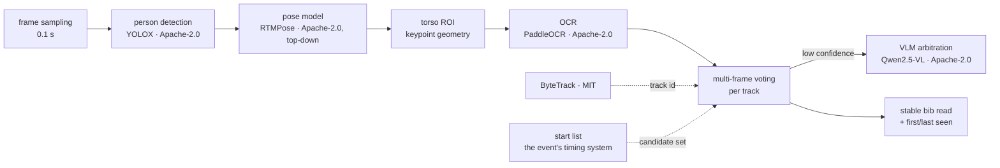

# bib-ocr-without-yolo

Design notes for a license-clean bib-number recognition pipeline.

> Spoiler: it is still a YOLO-family model. What we avoided is not the
> architecture — it is the **AGPL-3.0 license that ships with Ultralytics**.

This repository contains **no production source code**. The pipeline itself
stays closed. What is public here — and what was actually hard — is the
chain of decisions: why one popular option was legally off the table, what
replaced it, and how the replacement was validated on real race footage.


*The whole idea, drawn. Four keypoints, one rectangle, three lean angles —
and nothing here was trained on a bib. Generated by `tools/draw_roi.py` from
the same `torso_roi()` the pipeline uses, so this picture cannot drift from
the code; a test renders it again on every push and fails if it changed.*

---

## The story in one paragraph

A sports video platform needed a closed loop: long race recordings in,
individual athlete clips out, paid downloads attached. Somewhere in that
loop a machine has to read the number pinned to every runner's chest.
Before writing any code I did the license math, and mainstream YOLO
releases (YOLOv5/v8/11/26) failed it: AGPL-3.0 with a network clause that
reaches a SaaS backend, and it attaches to weights you fine-tune yourself.
The three legal exits — open-source the whole product, buy an enterprise
license, or swap in permissively-licensed components — left exactly one
that fit a small closed team. So the stack was rebuilt on Apache-2.0/MIT
parts, and the one component everyone expects to train (a bib detector)
was deleted entirely, replaced by a pose-keypoint prior.

## The one idea worth stealing

Race rules pin the bib to the torso. The torso is exactly the region
bounded by the shoulder and hip keypoints of any pretrained pose model.
So "detect the bib" — a problem that needs labeled data and training —
becomes "detect the human and apply anatomy" — a problem the pretrained
model solves for free.

What that buys:

- A race changes its kit color, its camera angle, its sport: nothing is retrained
- The ROI follows the body's lean instead of assuming a vertical rectangle
- The full keypoint set falls out anyway, ready for re-identification
  when multiple cameras must agree on the same athlete

What it costs: when the pose model is wrong, the crop is wrong with it, and
there is one geometric case it does not handle at all — see
[the limitation](#the-limitation-this-reference-code-does-not-fix).

## The pipeline, one diagram



Two dotted edges, and they are the ones that are easy to leave out. **ByteTrack**
is what turns frame reads into track conclusions. **The start list** is what
bounds the candidate set before a crop is even read — the reason a two-frame
track can still be published (see
[validation-method.md](docs/validation-method.md#why-a-two-read-track-is-still-published)).

## The decisions

| Role | Choice | License | Why | Rejected |
|---|---|---|---|---|
| Object detection | YOLOX | Apache-2.0 | Comparable capability, clean license | Ultralytics stack (AGPL-3.0) |
| ROI localization | RTMPose / RTMO | Apache-2.0 | Pretrained only; keypoints bound the bib region geometrically — zero annotation, zero training | Custom bib detector (annotation cost, poor generalization) |
| Text recognition | PaddleOCR | Apache-2.0 | Detection + recognition in one, charset can be constrained | Commercial cloud OCR (per-call cost) |
| Multi-object tracking | ByteTrack | MIT | Associates low-score boxes; occluded runners keep their ID | DeepSORT (older, heavier appearance dependency) |
| Low-confidence fallback | Qwen2.5-VL | Apache-2.0 | Arbitration only — rare poses, confusable characters | Full-volume VLM (cost) |
| Background subtraction | — | — | **Not viable**: the camera moves; the background never stands still | — |

## What is in here

```
docs/
  license-analysis.md    the AGPL math: why the default choice was not an option
  decisions.md           one entry per component: options, veto, consequence
  pose-prior.md          keypoint lineage, top-down vs bottom-up, topology mapping
  validation-method.md   how the numbers were measured, and what they do not claim
reference/
  roi_from_keypoints.py  the pose-prior ROI geometry, topology-agnostic
  bib_text_normalizer.py charset constraint + confusable-character repair
  frame_voting.py        per-track multi-frame voting
  demo.py                synthetic end-to-end run — clone, run, no GPU, no model
tests/
  test_reference.py      the geometry and the two rules, asserted on every push
tools/
  draw_roi.py            renders the figure above from the same geometry
artifacts/
  validation-run.sample.json   sanitized schema of the measurement we kept
.github/workflows/ci.yml       pytest on three Pythons, then this README's commands
```

`EVALUATION.md` is the one file here written for a buyer rather than an
engineer: which four numbers decide whether a bib pipeline works, which numbers
are decoration, and how to test one in an afternoon without a labeling team.

`reference/` is written from scratch for this repository: it demonstrates the
ideas, not the production code. It needs nothing beyond NumPy, downloads
nothing, and reads nothing.

```bash
pip install -r requirements-dev.txt
python reference/demo.py     # synthetic run: 40 frames, one runner, one bib
python -m pytest -q          # geometry + rules; no GPU, no model, no net
```

What `demo.py` prints, so you know what "working" is supposed to look like:

```
frames sampled        : 40
frames on track       : 30
valid reads           : 22
ROI angle span        : 0.0..27.1 deg (follows the lean)

conclusion: bib=A0030  evidence=22/30 frames  contested=False
```

Two counters, printed separately on purpose: 30 frames the runner was on
track, 22 of which produced a read good enough to vote. Collapsing them into
one number is how a track gets credited with reads it never made.

## How it was validated

Offline pass over a real 10K race clip:

```
36.5 s clip · 1080p · 2,190 frames decoded · 366 sampled (0.1 s interval)
205 person detections → 158 OCR candidates → 98 passing validation
→ 2 stable bib numbers (main subject visible in 141 of 176 samples,
  ≈0.9999 confidence)
≈ 3× the clip length on a laptop GPU — offline, where the deadline is the
next morning, not the next minute
```

Every frame's detections, OCR calls and timings were logged; every failure
case was archived by category. A confidence score is not an accuracy score:
99.9% is what the model said about one read, not what the pipeline gets
right across a race. `artifacts/` holds the sanitized schema of that
measurement so the discipline is reproducible even though the footage is not
public.

One of the two published tracks carries only two reads, and is published
anyway — because the candidate set is bounded by the event's starting list
before a crop is ever read. That argument, and why a two-frame track is not a
weak guess, is in [docs/validation-method.md](docs/validation-method.md).

## Known failure modes (and the defenses)

| Failure | Defense |
|---|---|
| Keypoint drift drags the ROI off the bib | Text detection inside the ROI as a sanity check; widen and retry when no text |
| Frame-to-frame ROI jitter hurts OCR | Temporal smoothing along the track |
| O/0, 8/B confusions | Multi-frame voting + low-frequency VLM arbitration |
| Experiments that cannot be reproduced | Fixed seeds and versioned data on a local GPU; cloud quotas for experiments only |

## The limitation this reference code does not fix

`width = shoulder_span × 1.3`. In a near-profile view the two shoulder
keypoints project to almost the same point: the span shrinks with the cosine
of yaw, so at 75° of turn the crop is about a quarter of its frontal width and
narrower than the bib itself. **Lean is handled** — the ROI axis rotates with
the shoulder-to-hip line, and `test_a_lean_rotates_the_crop_but_not_its_width`
would fail if the crop stopped following it. **Yaw is not.**

The fix is not a bigger multiplier. A bib is a fixed physical size, so a floor
tied to torso height (`width ≥ k × torso_height`) is the right invariant, and
the multiplier stays for the frontal case. It is not in `reference/` because
this file is the idea, and the idea is the prior — not the robustness layer
stacked on top of it. Naming it is worth more than pretending the number 1.3
covers it.

## Papers, if you want the primary sources

ByteTrack (ECCV 2022) · DeepSORT (Wojke et al., 2017) · Person Re-ID Survey (Ye et al., TPAMI 2021) ·
HRNet (CVPR 2019) · BlazePose / MediaPipe Pose (CVPR WS 2020) · RTMPose (arXiv 2023) ·
OpenPose (CVPR 2017) · DBNet (AAAI 2020) · PARSeq (CVPR 2022)

How these lines relate — and where MediaPipe sits among them — is laid out
in [docs/pose-prior.md](docs/pose-prior.md).

## What is deliberately not here

- **No production code, no model weights, no race footage.** The stack is
  closed by design — the license note above is the reason, not an excuse.
- **No photographs of athletes.** They were shown once, in context, on the
  portfolio site; a git repository is a permanent, forkable archive, and
  that is the wrong home for someone's face and race number.
- **No legal advice.** The license notes are a reading of the versions we
  shipped. Check your own deployment before reusing any of it.

## Credits

Selection and validation engineering by
[gavinforgelab](https://github.com/gavinforgelab); model and training work
was a collaboration with the team's vision lead. The pipeline runs in
production on a live sports media platform.

This is a design-notes repository. The production stack it describes —
training pipelines, model weights, the serving code — is closed by design.

## If you have this problem

The thing that reads a bib reads any printed identifier that has to become
data: a lane number, a helmet decal, a container code, a serial on a part.
The constraint that shaped this design — a closed product, a license that
stays out of it, and no appetite for an annotation budget — is the common
case, not the corner case.

To tell you what it would take, I need three things:

- **a sample** — 30 seconds of the footage, straight off the camera, unedited
- **the rules** — what the identifier encodes, and how the event or the process issues it
- **the output** — what has to come out the other end: an ID, a timestamp, a row in a table

gavinforgelab@gmail.com

## License

Two licenses, because prose and code are different artifacts:

- **Code** — `reference/`, `tests/`, `tools/`, `.github/` — is **MIT**. See `LICENSE`.
- **Prose and diagrams** — this README and everything under `docs/` — is
  **CC-BY-4.0**: quote it, adapt it, with attribution. See `LICENSE-docs`.

The split is not fussiness. Creative Commons itself recommends against using
its licenses for software: no patent grant, and terms written for text rather
than for something that gets built and shipped. A repository whose subject is
license hygiene should not be the one place where a text license is stretched
over Python.
