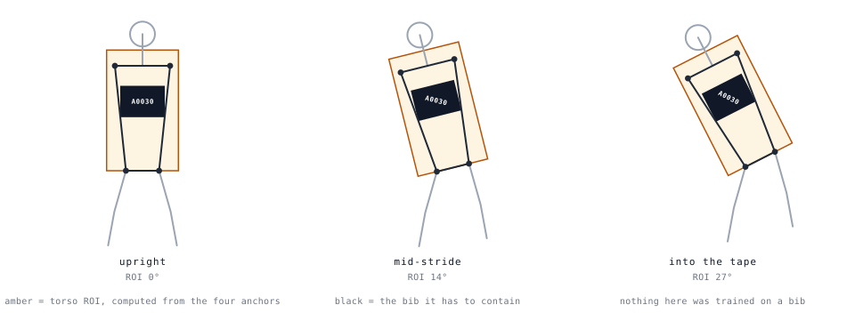

# The Pose Prior: lineage, trade-offs, and topology

> The pipeline's ROI is computed from pose keypoints — see
> [decisions.md D2](decisions.md). This document records the detail behind
> that decision: where keypoint models came from, which paradigm
> fits a field of small runners, and why the geometry only needs four
> anchors regardless of the model's topology.

## The lineage

MediaPipe is the ancestor of pose estimation *as a product* — not of the
method. The academic line ran first:

| Year | Model | Paradigm | What it added |
|---|---|---|---|
| 2017 | OpenPose (CVPR) | bottom-up, Part Affinity Fields | Every person in one pass; no detector needed |
| 2017 | AlphaPose / RMPE (ICCV) | top-down | Detector + single-person refinement; accuracy over throughput |
| 2019 | HRNet (CVPR) | top-down, high-resolution backbone | Kept full-resolution representations; the accuracy floor rose for everything after |
| 2020 | BlazePose / MediaPipe Pose (CVPR WS) | top-down, on-device | 33 whole-body points, real-time on a phone. **The moment pose became a product** |
| 2022 | ViTPose (NeurIPS) | top-down, transformer | Plain ViT beats dedicated architectures |
| 2023 | RTMPose (MMPose) | top-down, SimCC | The accuracy/latency Pareto front for server-grade realtime |
| 2023– | RTMO (MMPose) | one-stage | Detector-free; detection and pose in one pass |

Two parallel branches, then: the **HRNet → MMPose → RTMPose** line we
shipped from, and the **BlazePose → MediaPipe** line that made the world
believe pose estimation was a solved, embeddable thing. Credit where due:
MediaPipe is why "give me the keypoints" is a reasonable expectation in
2026 at all.

## The trade-off that decided our deployment

Bottom-up (OpenPose-style) reasons about every person in one pass —
attractive when the frame is crowded. Top-down runs a person detector,
then refines each person's keypoints on a full-resolution crop.

Our frames are the hostile case for bottom-up: a road race sampled at
1080p, where a runner forty meters back is **30–80 pixels tall**. Bottom-up
keypoint quality collapses exactly there — the group map that finds people
cheaply also blurs the joints of the smallest ones. Top-down pays one crop
per person but refines each at usable resolution, and our 0.1 s sampling
keeps the person count per frame modest.

So: **top-down, server-grade (RTMPose/RTMO), one crop per runner.** The
edge-friendly elegance of MediaPipe is the wrong fit for a batch pipeline
that must not miss the small runners — they are the back of the pack, and
the back of the pack paid for the video too.

## Why MediaPipe was evaluated and still vetoed

To be explicit, because the obvious first question is licensing:
**MediaPipe is Apache-2.0.** It was never a legal veto. It lost on the
engineering:

- optimized for single-subject, device-class inference; a start-line
  sprint with seven overlapping runners is outside its comfort zone
- the bundled models are quantized for phones and browsers — accuracy on
  distant, small runners is not the priority it was designed around
- the newer Tasks API supports multi-pose, but the accuracy story on our
  target regime (small, dense, outdoor) was not competitive with a
  top-down model given full-resolution crops

Recorded as a real veto of a *legal* option, because a decision table
where every row was forced by law is a decision table that hides its
engineering.

## The geometry only needs four anchors

The ROI uses four keypoints: left/right shoulder, left/right hip. Everything
else the model outputs is a bonus (re-identification features, occlusion
checks, runner counting). Four anchors means the geometry does not care
which topology produced them — only that the four are labeled the same way:

| anchor | COCO-17 | MediaPipe-33 |
|---|---|---|
| left shoulder | 5 | 11 |
| right shoulder | 6 | 12 |
| left hip | 11 | 23 |
| right hip | 12 | 24 |

The mapping lives in
`reference/roi_from_keypoints.py` as `KEYPOINT_TOPOLOGIES`; switching model
families is a one-line change, and `test_topology_does_not_change_the_roi`
asserts the same synthetic pose yields the same ROI under both — so the claim
fails in CI rather than in a sentence.

## Confidence gating, and what it buys

Every anchor keypoint carries a model-reported confidence. The ROI
refuses to compute when any of the four falls below a threshold (0.3 in
our deployment). This is the cheapest defense in the whole pipeline: a
partially hallucinated hip joint produces a confidently wrong crop, and a
confidently wrong crop produces garbage OCR — which the funnel would then
have to un-believe. Refusing to guess costs one skipped frame; guessing
costs a poisoned vote. See [decisions.md D7](decisions.md) for the
defenses this feeds.

## Papers, if you want the primary sources

- OpenPose: Cao et al., *Realtime Multi-Person 2D Pose Estimation using Part Affinity Fields*, CVPR 2017
- AlphaPose: Fang et al., *RMPE: Regional Multi-person Pose Estimation*, ICCV 2017
- HRNet: Sun et al., *Deep High-Resolution Representation Learning*, CVPR 2019
- BlazePose: Bazarevsky et al., *BlazePose: On-device Real-time Body Pose Tracking*, CVPR Workshop 2020
- ViTPose: Xu et al., *ViTPose: Simple Vision Transformer Baselines*, NeurIPS 2022
- RTMPose: Jiang et al., *RTMPose: Real-Time Multi-Person Pose Estimation*, arXiv 2023
